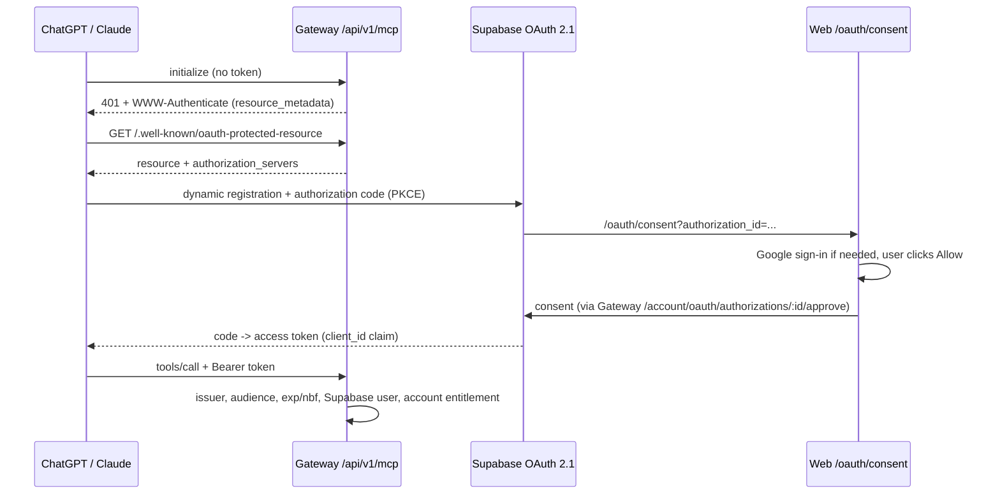

# Gateway MCP server (ChatGPT, Claude and other MCP clients)

Besides the Custom GPT Action API, the Gateway exposes a remote MCP endpoint:

```text
https://<gateway-api-domain>/api/v1/mcp
```

Transport: MCP Streamable HTTP, stateless, JSON responses (`POST`; `GET`/`DELETE` return `405`).
Authentication: OAuth 2.1 with PKCE and Dynamic Client Registration, using the
**Supabase OAuth 2.1 server** of the same Supabase project as the web app.



## Tools

| Tool | Purpose |
| --- | --- |
| `gateway_profile` | Services in the account and whether each is connected |
| `list_tools` | Current tools of one connected service |
| `get_tool_schema` | Input schema of one service tool |
| `call_tool` | Execute a service tool (`destructiveHint: true`, clients may ask for confirmation) |

Provider catalogs differ per user and change at runtime, so the endpoint uses
the same discovery protocol as the GPT Action rather than a fixed tool list.
Every `tools/call` re-checks the **account entitlement**: members are always
allowed; guests are allowed while their one-time 7-day trial is active.
Otherwise the tool returns `MEMBERSHIP_REQUIRED`. Open IDs and Gateway tokens
are only used by the Custom GPT Action flow; the plugin does not need one.

## Security boundaries

- Tokens must be accepted by Supabase (`auth.getUser`) and carry `client_id`,
  issuer `<SUPABASE_URL>/auth/v1` and audience `MCP_OAUTH_AUDIENCE`
  (default `authenticated`), and be within `exp`/`nbf`.
- OAuth client tokens are rejected on all dashboard/REST APIs
  (`OAUTH_CLIENT_TOKEN_NOT_ALLOWED`), so a connector cannot create Gateway
  tokens or read account data outside the MCP tools.
- The consent page only approves clients whose redirect URI is HTTPS on
  `MCP_OAUTH_ALLOWED_REDIRECT_HOSTS` (default
  `chatgpt.com,openai.com,claude.ai,claude.com,grok.com,console.x.ai`).
- Signing in on the consent page never approves by itself.
- Provider credentials stay encrypted in the Gateway and never reach the client.

## Setup

### 1. Supabase

Authentication → **OAuth Server**:

- enable the OAuth 2.1 server;
- **Authorization path**: `/oauth/consent` (the Site URL must be the web app, e.g. `https://<web-domain>`);
- enable **Dynamic OAuth Apps** (dynamic client registration).

Authentication → URL Configuration → Redirect URLs: keep
`https://<web-domain>/auth/callback` (Google sign-in resumes the consent page
through it).

### 2. Server environment

Required (already used elsewhere): `GATEWAY_PUBLIC_BASE_URL`, `WEB_BASE_URL`,
`SUPABASE_URL`, `SUPABASE_ANON_KEY`.

Optional:

```env
MCP_OAUTH_AUDIENCE=authenticated
MCP_OAUTH_ALLOWED_REDIRECT_HOSTS=chatgpt.com,openai.com,claude.ai,claude.com,grok.com,console.x.ai
```

### 3. Check

```bash
curl -i https://<gateway-api-domain>/api/v1/mcp -X POST -H 'Content-Type: application/json' -d '{}'
# 401 with a WWW-Authenticate header pointing at the metadata URL
curl https://<gateway-api-domain>/.well-known/oauth-protected-resource
```

### 4. Connect a client

**ChatGPT** → Settings → Apps / Connectors → Add custom MCP server:

- Name: `MCP Gateway`;
- Connection: Server URL `https://<gateway-api-domain>/api/v1/mcp`;
- Authentication: **OAuth** (leave advanced settings on auto-discovery).

**Claude** → Settings → Connectors → Add custom connector with the same URL.

The client opens the Gateway consent page; sign in with the same Google account
used in the Gateway web app and click **Allow**. Then ask, for example,
"list my recent Google Drive files".
